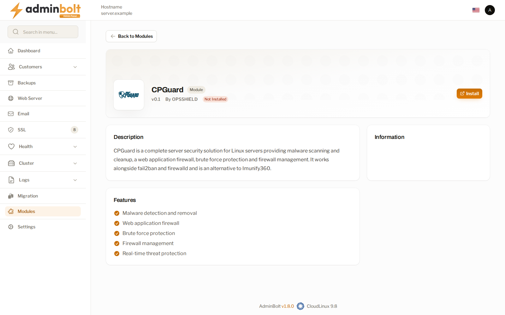

cPGuard can be integrated with the AdminBolt control panel to provide server security features, including malware scanning, a web application firewall (WAF), and login protection.

cPGuard can be installed from the AdminBolt control panel under **Health > Security** or **Module Manager**. The installer will prompt you to enter a valid license key.

For detailed instructions, refer to the [AdminBolt cPGuard Installation Guide](https://docs.adminbolt.com/user-guide/admin-panel/modules-cpguard).

## Accessing the App Portal

cPGuard is managed through its online App Portal, which can be accessed directly from AdminBolt:

1. Click **Open cPGuard Dashboard** to open the portal access page.
2. Select **Continue to App Portal**. AdminBolt generates a sign-in link for the server and opens the portal in a new browser tab.

If the portal does not open, allow pop-ups for the AdminBolt panel and try again.

## cPGuard Client Plugin

The client plugin allows hosting clients to use cPGuard's native interface instead of the default AdminBolt scan page.

- **Default state:** Disabled.
- **To enable:** Go to **Service and Licence**, select **Enable the client plugin**, and confirm the action.
- **Client access:** Clients whose hosting plans include the cPGuard feature can access it under **Security > cPGuard**.

## Scans

Administrators can use cPGuard to scan individual hosting accounts or the entire server:

- **Scan an account:** Scans all files in the selected account's home directory.
- **Scan whole server:** Scans all directories in cPGuard's watch list.

Administrators can view scan results, stop running scans, and delete completed scan records.

### Watch List Synchronization

cPGuard monitors the document roots of hosted domains. AdminBolt automatically synchronizes the watch list whenever domains are created, modified, renamed, imported, or removed. It also performs periodic checks to ensure the list remains current.

## Requirements for cPGuard WAF

To use cPGuard's WAF rules in AdminBolt:

- Ensure that **OWASP ModSecurity Core Rules** are disabled under **Rule Packs**.
- Ensure that ModSecurity is enabled and properly configured. See the [AdminBolt ModSecurity Configuration Guide](https://docs.adminbolt.com/user-guide/admin-panel/apache-modsecurity-config).
